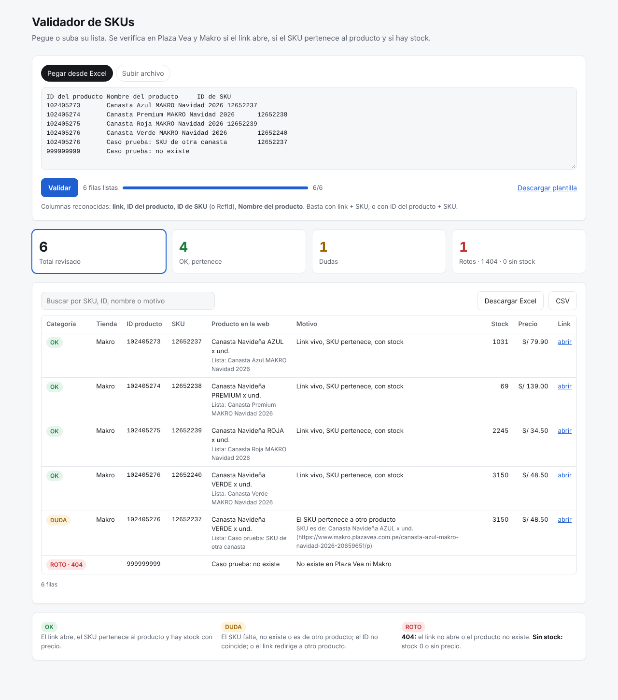

# Validador de SKUs · Plaza Vea / Makro

Página web donde los analistas pegan o suben su lista (link + SKU, o ID de producto + SKU) y obtienen
la clasificación **OK / DUDA / ROTO** con stock, precio y una descarga en Excel.

| Archivo | Qué es |
|---|---|
| `server.py` | Servidor web (solo la biblioteca estándar de Python). Sirve la página y `POST /api/validar` |
| `monitor.py` | Lógica de validación. También se usa por línea de comandos: `python3 monitor.py lista.xlsx -o resultado.xlsx` |
| `static/index.html` | La página |
| `Dockerfile`, `render.yaml` | Para desplegarlo |



## Correrlo localmente
```bash
python3 server.py          # abrir http://localhost:8080
```

## Publicarlo (elija una opción)

**Render (gratis, sin instalar nada)**
1. Suba esta carpeta a un repositorio de GitHub.
2. En render.com: New → Blueprint → elija el repositorio. Render lee `render.yaml` y entrega la URL pública.
   (En el plan gratuito, el servicio se apaga si nadie lo usa; la primera consulta después de eso demora ~30 s).

**Google Cloud Run**
```bash
gcloud run deploy validador-skus --source . --region us-central1 --allow-unauthenticated
```

## Reglas de clasificación (en orden)
1. **ROTO · 404**: el link no abre, va a `/Sistema/404`, o el producto/SKU no existe en Plaza Vea ni en Makro.
2. **DUDA**: falta el SKU, el SKU no existe o pertenece a otro producto, el ID de producto no coincide, o el link redirige a otro producto.
3. **ROTO · SIN STOCK**: el SKU coincide, pero el stock es 0 o no tiene precio.
4. **OK**: el link abre, el SKU pertenece al producto y hay stock con precio.

## Variables opcionales
`PORT` (8080), `WORKERS` (8 consultas en paralelo por lote), `MAX_BATCHES` (3 lotes simultáneos en todo el servidor).

## Precio con Tarjeta Sip
Para cada producto se informa `tiene_sip`, `precio_sip` y el descuento:
- `dscto_sip_soles` y `dscto_sip_pct`: precio online − precio SIP.
- `dscto_sip_vs_regular_pct`: contra el precio regular (tachado).

El precio SIP se calcula igual que la web de Plaza Vea, desde la promoción "TARJETA OH…" del
producto (`PromotionTeasers`): precio sin descuento − monto de la promoción. Ejemplo: regular S/ 499,
promoción S/ 130 → precio SIP S/ 369. Solo cuenta si es menor al precio online.
